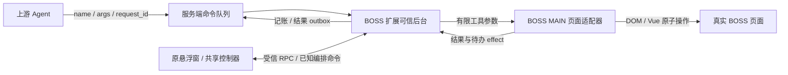

# 扩展执行与兼容边界

## 一个仓库、两个产品

`apps/boss-agent` 和 `apps/application-autofill` 分别构建为完整 MV3 扩展。它们没有共享 background、chrome.storage、token、执行队列或跨扩展消息。网申包不声明 BOSS 域名或 Agent 工具权限；BOSS 包不提供网申自动提交能力。

## BOSS 完整功能与原生底层

迁移保留原悬浮窗、投递控制、进度、会话和设置，不改变原使用方式。原完整实现迁到 `packages/boss-core/src/`，不再以油猴目录作为扩展的业务来源；只有 `legacy/userscript/src/` 保留 GM API 和开发加载器。

共享 `PlatformRuntime` 声明存储、网络、通知和同步配置快照接口；历史入口安装 GM adapter，MV3 后台使用 `NativeStorage` 与 `NativeNetwork`。原生存储保留既有 runtime key 和回执，清理限定命名空间；网络限定后端 origin（含端口）、方法、路径与认证头，使用 fetch，不提供页面通用代理。原生请求继承会话取消，响应读完后再次检查当前账号。

完整面板由 `panel.html` 的受信扩展 iframe 挂载原 App，先预热同步配置快照，再安装原生平台和会话驱动。收起只改变 iframe 尺寸，不卸载执行器。内容脚本只传递几何信息、页面状态和生命周期，不持有 token。后台利用 webNavigation 校验 iframe 的扩展 URL、frame/document、直属父 frame 和真实 BOSS 顶层页面；通知通过原生 notifications API 发出。

原 ApplyEngine、Orchestrator、会话 runner、台账和设置复用共享 core。控制器只通过固定 DTO 调用 MAIN 的平台扫描/投递/翻页、会话读取/回复/简历/清理；后端仍是策略和计划的唯一来源。所有页面调用共用原有执行租约，副作用先持久化稳定键和参数指纹，读取不占长期收据容量。停止、切账号和退出立即取消旧动作；账号变更销毁旧面板实例，不能把旧控制器的异步写入带到新账号。

稳定工具定义由共享页面工具工厂维护，原油猴与 MV3 分别注入其运行环境。MV3 的纯工具目录声明名称、描述、不可撤回标记和参数 JSON Schema；后台可以导入目录而不加载网页代码。Agent 的判断留在服务端，扩展不增加一套业务决策模型。

MAIN 模块复用 BOSS 真实页面函数以读取未混淆薪资、虚拟会话列表和平台回执。构建只对该模块替换网络、配置、日志及台账依赖：MAIN 只能取得本次需要的问候语/简历标签，拿不到 JWT、通用 HTTP 或扩展存储。后台只执行固定 API 路径和明确的效果类型；页面观察不能授予特权。

配置、凭据及命令收据仅保存在受信扩展存储。固定 API 为生产域名，本地 HTTP 只允许 loopback；自定义 HTTPS 地址由面板或 popup 的用户操作显式申请 host 权限。禁止网页发起任意 URL/token/header 代理。

## 生命周期与副作用

- 一个选定 BOSS 标签页/文档执行命令，其他标签页只能报告连接状态；停用、退出和切账号会撤销旧执行 lease。
- 页面内容脚本报告生命周期/tick及未读角标，另负责受限的面板几何消息。后台在已验证的执行文档上以约2秒间隔请求一次真实心跳，完成后才安排下一次，不制造空消息保活；内容脚本10秒原生tick兜底，1分钟alarm在worker恢复时重新核对执行页。页面超时/冻结停止短循环，不把定时器目标当作实际响应保证。实现遵循 [Chrome service worker 生命周期](https://developer.chrome.com/docs/extensions/develop/concepts/service-workers/lifecycle)。
- 执行前持久化 started 收据，执行后先保存结果及效果 outbox。服务端结果回传、投递记账与页面动作分开；网络失败重传回报，不重复点击。
- worker 重启遇到 started 收据时返回 reconciliation_required。页面操作与落盘之间无法构成原子事务，不承诺 exactly-once；投递/消息/删除等未知终态必须只读核查。
- 导航/刷新是持久化结果之后的效果；跨页会话目标由后台保存，新文档恢复打开目标会话。
- 跨页定位最多尝试5次，计数随worker重启保留；歧义立即终止。原命令先回报 navigating，定位后更新为实际成功/失败。失败后继续接受诊断，已知写入工具返回明确拒绝并ACK，避免堵住后续只读命令；未知命令仍不ACK。显式 open_thread 唯一匹配成功后解除限制。
- 页面冻结时不能执行 DOM；页面恢复后重新确认文档和命令状态，不把轮询超时当作平台失败。

现有后端队列按 user 隔离，尚不提供旧油猴与新 BOSS 扩展的自动 owner 交接。启用新客户端前必须停旧客户端并刷新旧页面；两个独立产品并存是 BOSS 扩展与网申扩展，不是两个 BOSS 执行端双跑。

迁移前先让旧客户端停止原编排任务并确认停止命令的 ACK。新扩展复用原命令 dispatcher，后台将已知 `orchestrator.*`、start/stop、会话操作交给受信面板；不启动旧 remote 轮询。长动作执行期间 stop/pause 可以先送达并撤销页面执行，但 ACK 必须等前序命令有明确中断/完成记录后连续推进。未知命令不执行、不越过 ACK。

主动导航先持久化 pendingAction，由新页面恢复原控制器；意外断连、刷新或 worker 重启保留未确认收据，持久化暂停状态和事件 outbox，等待显式恢复与核查。core 状态按后端与用户分区；清理 core 存储不会删除后台命令回执。

## Function call 和后端兼容

`GET /api/plugin/tools` 是新增的只读发现接口，返回 function 结构及参数 schema。旧工具没有 schema 时仍保留原调用兼容性，但不会伪造 function 参数。命令继续使用 protocol=2、command_ack_v2、tools_v1；旧服务端没有发现接口时仍可通过新扩展 list_tools 取得目录。

`POST /api/plugin/tools/call` 新增可选 request_id。相同用户、相同 ID 和参数返回原 command_id；同 ID 不同参数返回409。省略 request_id 的旧调用行为保持兼容。幂等信息保存在现有命令 payload，不新增数据库结构；生产 MariaDB 以用户行锁串行化查重与入队。

| 组合 | 行为 |
|---|---|
| 原油猴 + 配套后端 | 既有接口和协议继续可用 |
| BOSS MV3 + 配套后端 | 原悬浮窗、投递/进度/会话/设置与编排；21 原子工具、schema 发现和稳定调用ID；唯一后台心跳及 ACK |
| 未确认握手 / 未知命令 | 不执行，不推进 ACK |
| BOSS 工具执行中断 | 待核查，不自动重新发送/投递/删除 |
| 跨页会话不存在 / 多条匹配 | 有界失败，原 command_id 可查询终态；不改选公司首条 |
| scan_jobs 带 JD | 缺省最多10条，可选 offset/limit，返回 nextOffset；旧无明细调用仍返回整页 |
| 网申 + 同一后端 | 仍用其资料 API 和独立登录，不消费 tool.call |

生产 API 单 worker 的现有约束保持不变。新扩展并不意味着服务端已部署最新发现/幂等接口。

## 验收与回滚

实际 ZIP/manifest/静态本地脚本检查、类型检查和聚焦契约是本地门槛；不能代替 Chrome/Edge 加载、登录、冻结恢复和真实 BOSS DOM 验收。真实写入动作必须在明确目标与授权下核对平台回执和服务端记账。

首次切换 BOSS 执行端时，先暂停上游 Agent，等待已领取动作完成；对投递、发送、删除等未知终态先只读核查。停用旧油猴并刷新所有 BOSS 页面后，再从原悬浮窗登录新扩展并选择简历；需要指定执行页或重新启用时使用辅助 popup。不能把旧油猴的存储或执行中命令当作已自动迁入新扩展。

两个扩展的 ZIP 必须分别解压到固定目录，再加载直接包含 manifest 的产品目录；公共 `dist/` 不是扩展。后续升级覆盖原安装路径，重载扩展并刷新业务页面。本清单未固定扩展 key，改换目录加载会产生新的扩展 ID；旧 ID 下的存储不会自动搬迁。

原网申从 `browser-extension/dist/` 迁入 `dist/application-autofill/` 时，先停用旧网申并刷新所有 ATS 页面，再安装新副本并重新登录。内容脚本的全局去重只属于各自隔离环境，不能防止两个不同 ID 的网申扩展同时显示或填写。保留旧安装目录；本页临时修改、登录和缓存不作跨 ID 自动迁移。

回滚 BOSS 时先暂停 Agent，停用新 BOSS 扩展，核查不确定副作用与待回报队列，刷新所有 BOSS 页面终止新实例，再启旧油猴。网申扩展不参与这一执行权交接，也不因 BOSS 回滚被强制降级。回滚网申时先停用新网申并刷新 ATS 页面，再启用原目录的旧扩展、检查登录和资料；网页上已填写的内容仍需用户核对，不自动撤销。
